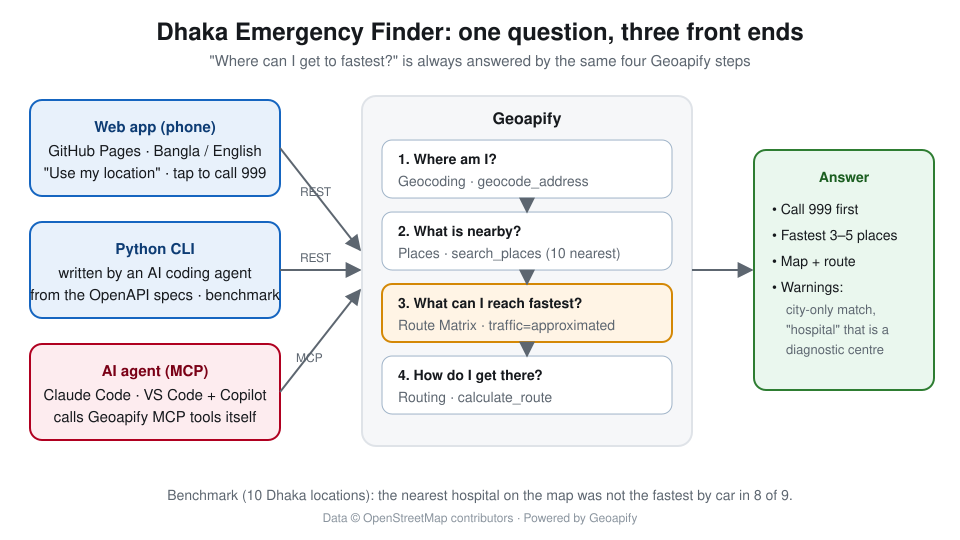

# Dhaka Emergency Finder

> **Emergency in Bangladesh? Call 999 first.** This project helps you find a facility. It does not replace emergency services.

Find the hospital, pharmacy, police station or fire station in Dhaka that you can **reach fastest**, ranked by real travel time instead of straight-line distance. Your location can be informal text, Bangla script or coordinates.

There are two ways to use it:

| | What it is | Geoapify |
|---|---|---|
| **AI agent** | Ask in plain English or Bangla in an MCP client such as Claude Code or VS Code + Copilot (both tested), or Claude Desktop | [Geoapify MCP](https://apidocs.geoapify.com/mcp/) tools |
| **CLI** | `python -m dhaka_emergency "Mirpur 10"`, built with an AI coding agent from the specs | [Geoapify OpenAPI specs](https://apidocs.geoapify.com/open-api/) → REST APIs |
| **Web app** | [Open on your phone](https://abdullah-atif.github.io/dhaka-emergency-finder/app/): use my location, tap to call 999, Bangla / English | Geoapify REST APIs from the browser |



Built for the [Geoapify Open Geospatial Program, Batch #2: AI × Geospatial](https://www.geoapify.com/open-geospatial-program/).

**Status:** working prototype (v0.1.0). The CLI is unit-tested and has been run against the live APIs. The
10-location benchmark, three recorded agent sessions (Claude Code and VS Code + Copilot), the [tutorial](docs/tutorial.md) and the
[feedback report for Geoapify](docs/feedback.md) are done (see [Roadmap](#roadmap)).

## Results (live Geoapify APIs, 2026-10-21)

From the [10-location Dhaka benchmark](benchmark/results.md) ([manual review](benchmark/NOTES.md)):

| Finding | Result |
|---|---|
| The nearest hospital **on the map** was **not** the fastest to reach by car | **8 of 9** locations; **at least 1 min** faster in 6 of 9 (up to 6.9 min) |
| The fastest "hospital" is, by its name, a diagnostic centre or eye hospital | **3 of 9**, now flagged by the CLI |
| Geocoding found the right place | **8 of 10**: English 4 / 6, **Bangla 4 / 4** |
| Silent fallback to the whole city, visible only in `match_type` ("Dhanmondi 27, Dhaka") | 1 of 10, now detected and warned by the CLI. The same place in Bangla (`ধানমন্ডি ২৭`) works. |
| `"BUET, Dhaka"` / full English name | wrong place (Gulshan / a company in Banani). **`বুয়েট` in Bangla: correct.** |

Recorded AI-agent sessions with every Geoapify MCP tool call:
[fastest hospital from Mirpur 10](agent/sessions/01-mirpur-hospital.md) ·
[asked in Bangla, inside Claude Code](agent/sessions/02-farmgate-claude-code-bangla.md) ·
[VS Code + GitHub Copilot](agent/sessions/03-mirpur-vscode-copilot.md)

### Sample output

```text
$ python -m dhaka_emergency "Farmgate, Dhaka" --top 2
!! Emergency? Call 999 first.

From: Farmgate, Airport Road, Tejgaon, Dhaka - 1215, Bangladesh
Nearest hospital (by drive travel time):

1. Al Fateh Diagnostics
   1 min | 0.3 km by road | 0.3 km straight line
   Note: the name suggests this may not have an emergency department
   Kazi Nazrul Islam Avenue, Tejgaon, Dhaka - 1215, Bangladesh
2. Brain and Mind Hospital
   1 min | 0.5 km by road | 0.3 km straight line
   Airport Road, Tejgaon, Dhaka - 1215, Bangladesh
```

```text
$ python -m dhaka_emergency "Dhanmondi 27, Dhaka"
From: Dhaka, DH, Bangladesh
!! Could not find 'Dhanmondi 27, Dhaka' exactly; only 'Dhaka, DH, Bangladesh' matched.
   Results are around that centre, not your location.
   Try a nearby landmark, a different spelling, Bangla script, or "lat,lon".
```

## Why travel time?

In Dhaka the closest facility on a map is often not the fastest to reach. Rivers, canals, one-way roads and dense traffic change the answer. The tool takes up to 10 nearby candidates and ranks them with the Route Matrix API (`traffic=approximated`). It also tells you when the closest facility on the map is *not* the fastest one.

## How it works

```
location text / "lat,lon"
   │  Forward Geocoding API      (MCP: geocode_address)       filter=countrycode:bd, bias=Dhaka
   ▼
origin (lon, lat)
   │  Places API                 (MCP: search_places)         radius 2 km → 5 km → 10 km
   ▼
up to 10 candidates
   │  Route Matrix API           (MCP: calculate_route_matrix) drive / motorcycle / walk
   ▼
ranked by travel time
   │  Routing API                (MCP: calculate_route)        route to #1 for the map
   ▼
terminal table / JSON / HTML map (Leaflet + Geoapify tiles)
```

> **Why OpenAPI + MCP?** The same task is solved twice: by an AI agent that calls Geoapify MCP tools at run
> time, and by a small CLI that an AI coding agent wrote from the Geoapify OpenAPI specs. Comparing the two shows
> where each approach is reliable (see the [agent sessions](agent/sessions/) and the [benchmark](benchmark/)).

| Type (`--type`) | Geoapify category |
|---|---|
| `hospital` | `healthcare.hospital` |
| `clinic` | `healthcare.clinic_or_praxis` |
| `pharmacy` | `healthcare.pharmacy` |
| `police` | `service.police` |
| `fire` | `service.fire_station` |
| `ambulance` | `emergency.ambulance_station` |

## Quick start: CLI

You need Python 3.9 or newer. There are no third-party packages.

1. Get a free API key at <https://myprojects.geoapify.com>.
2. Set it as an environment variable:

   ```bash
   # macOS / Linux / Git Bash
   export GEOAPIFY_API_KEY=your_key
   # Windows PowerShell
   $env:GEOAPIFY_API_KEY = "your_key"
   ```
3. Run it:

   ```bash
   python -m dhaka_emergency "Mirpur 10, Dhaka"
   python -m dhaka_emergency "ধানমন্ডি ২৭" --type pharmacy
   python -m dhaka_emergency "23.7806, 90.4193" --type fire --mode motorcycle --map out.html
   python -m dhaka_emergency "Uttara Sector 7" --type police --json
   ```

| Option | Meaning |
|---|---|
| `--type` | `hospital` (default), `clinic`, `pharmacy`, `police`, `fire`, `ambulance` |
| `--mode` | `drive` (default), `motorcycle`, `walk` |
| `--top N` | number of results (default 5) |
| `--map FILE.html` | write an HTML map with all results and the route to #1 |
| `--json` | machine-readable output |

> The HTML map contains your API key (for map tiles). Do not publish generated maps.
>
> The hosted web app uses its own free demo key in `docs/app/config.js`, restricted in Geoapify to this site's
> address. Don't reuse that key elsewhere; get your own at <https://myprojects.geoapify.com>.

## Quick start: AI agent (MCP)

1. Connect your AI client to Geoapify MCP: see [agent/MCP_SETUP.md](agent/MCP_SETUP.md) (Claude Code, VS Code, other clients).
2. Give it the instructions in [agent/AGENT_INSTRUCTIONS.md](agent/AGENT_INSTRUCTIONS.md).
3. Ask: *"I am at Mirpur 10 golchottor. Where is the fastest hospital to reach by car?"*

## Tests

```bash
python -m unittest discover -s tests -v      # CLI (Python)
node --test tests/app.test.js                 # web app helpers (Node 18+)
```

The tests use a fake client, so they need no API key or network.

Manual checklist for real API runs:

- [ ] English place name → correct Dhaka location
- [ ] Bangla-script place name → correct location, or a clear "not found" message
- [ ] `lat,lon` input skips geocoding
- [ ] Each `--type` returns results in central Dhaka
- [ ] `--map` opens in a browser and shows markers and the route
- [ ] Missing key → clear error message, exit code 1
- [ ] `--sort size` lists the biggest first; containing-building sizes are shown with `<=`

## Repository layout

```
dhaka_emergency/     CLI package (geoapify.py = REST client, finder.py = logic, mapview.py = HTML map)
agent/               agent instructions + MCP setup for AI clients
prompts/             prompts given to the AI coding agent, with corrections
docs/ai-log.md       what worked, what needed human guidance
docs/app/            web app (static page on GitHub Pages; config.js holds the optional demo key)
docs/tutorial.md     the tutorial (served by GitHub Pages; docs/devto.md is the dev.to copy)
docs/feedback.md     feedback for Geoapify OpenAPI specs and MCP tools
benchmark/           Dhaka test locations, runner (run.py), results and manual review notes
agent/sessions/      recorded agent sessions: write-up (.md) + full MCP transcript (.jsonl)
agent/mcp_call.py    call one Geoapify MCP tool over JSON-RPC and log it (for agents without an MCP client)
tests/               unit tests
```

## Known limitations

- The data comes from OpenStreetMap. Some hospitals are missing, have no phone number, or do not mark whether they have an emergency department.
- `traffic=approximated` is an estimate. It is not live Dhaka traffic.
- There are no CNG auto-rickshaw or rickshaw travel modes. `motorcycle` is the closest option.
- Geocoding of informal English names can fail or land in the wrong place, sometimes still reported as `full_match`
  (see [benchmark/NOTES.md](benchmark/NOTES.md)). Bangla script often works better. Otherwise use `lat,lon`.
- The "not an emergency hospital" flag is a name-based heuristic, not verified data.
- The tool does not know opening hours, bed availability or emergency capacity.
- Landmark geocoding can be wrong: "BUET, Dhaka" matched a building with "BUET" in its name in Gulshan instead of the BUET campus in Palashi.

## Roadmap

- [x] CLI: geocode → places → route matrix → ranked list, HTML map, JSON, tests
- [x] Agent instructions + MCP setup (Claude Code, VS Code)
- [x] Benchmark: 10 Dhaka locations (English + Bangla pairs). Compare straight-line nearest with travel-time nearest, and measure geocoding success (`python benchmark/run.py`).
- [x] First recorded agent sessions with full MCP tool-call transcripts ([agent/sessions/](agent/sessions/))
- [x] [Tutorial](docs/tutorial.md) (GitHub Pages; dev.to copy in [docs/devto.md](docs/devto.md))
- [x] [Feedback report for Geoapify OpenAPI / MCP](docs/feedback.md)

## License

[MIT](LICENSE) © 2026 Abdullah Atif. Map data © OpenStreetMap contributors, powered by [Geoapify](https://www.geoapify.com/).
