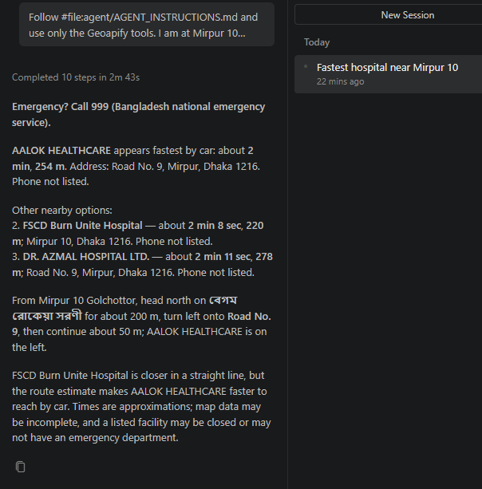

# Session 03: VS Code + GitHub Copilot, "fastest hospital from Mirpur 10"

- **Date:** 2026-10-21
- **Client:** VS Code 1.142 with GitHub Copilot Chat 0.70 in **Agent** mode, model picker on "Auto" (the run used
  `gpt-6-luna`). VS Code's own MCP client connected to `https://api.geoapify.com/v1/mcp`.
- **Prompt:** `Follow #file:agent/AGENT_INSTRUCTIONS.md and use only the Geoapify tools. I am at Mirpur 10 golchottor. Where is the fastest hospital to reach by car?`
- **Full transcript (Geoapify calls, arguments, results, final answer):** [03-mirpur-vscode-copilot.jsonl](03-mirpur-vscode-copilot.jsonl)
- 10 steps, 2 min 43 s

## Tool calls

| # | Tool | Key arguments | Outcome |
|---|---|---|---|
| 1 | `geocode_address` | `"Mirpur 10 golchottor, Dhaka, Bangladesh"`, `country_codes: ["bd"]` | Mirpur 10 Bus Station (23.8074, 90.3682) |
| 2 | `search_places` | `healthcare.hospital`, 2 km, limit 10 | 10 places. The result (18.6 KB) was too big for Copilot's context, so it was saved to a temp file and read in parts. |
| 3 | `calculate_route_matrix` | 1 × 10, `drive`, **`traffic: "approximated"`** | Same times as session 01 (AALOK HEALTHCARE 120 s) |
| 4 | `calculate_route` | to AALOK HEALTHCARE, `traffic: "approximated"`, `include_instructions: true` | 254 m, 121 s |

Between the Geoapify calls, Copilot used its own `tool_search_tool` (to load the MCP tools) and `view` (to read files).

## Final answer (as shown in the screenshot)

> **Emergency? Call 999.** AALOK HEALTHCARE appears fastest by car: about 2 min, 254 m … 2. FSCD Burn Unite Hospital,
> about 2 min 8 sec, 220 m … 3. DR. AZMAL HOSPITAL LTD., about 2 min 11 sec, 278 m … FSCD Burn Unite Hospital is
> closer in a straight line, but the route estimate makes AALOK HEALTHCARE faster to reach by car.

## What worked
- **The same answer from a different client and model.** VS Code + Copilot (an OpenAI model) gave the same ranking and
  times as Claude Code in session 01. The Geoapify tools return the same data whichever client calls them.
- **It followed the instructions, including `traffic: "approximated"`** on both the matrix and the route. This was
  the rule added after sessions 01 and 02.
- It reported the straight-line vs. road difference and missing phone numbers, as instructed.

## What went wrong: the agent read the API key
- **Copilot read `.vscode/mcp.json` on its own (`view` tool) before starting**, and VS Code allowed it after a
  permission prompt. For this test the file held the Geoapify key in plain text, so **the key was sent to the model
  provider**. A key exposed like this should be treated as leaked and replaced.
- **Lesson:** never write the key into `mcp.json`. Use VS Code's `inputs` prompt (`${input:geoapify-key}`), as in
  [`vscode-mcp.example.json`](../vscode-mcp.example.json). Deny file-read requests for config files.
- Setup surprise: pressing **Start** on the server before sending any chat message fails with *"Cannot start an MCP
  server before the session runtime has been created. Send a message first."* Just send the question; the server
  starts on its own.
